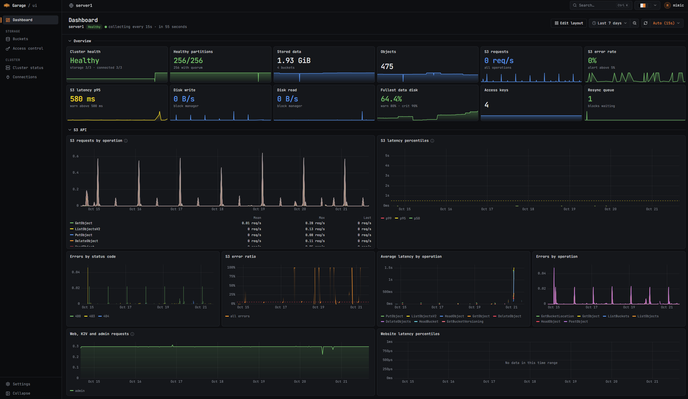
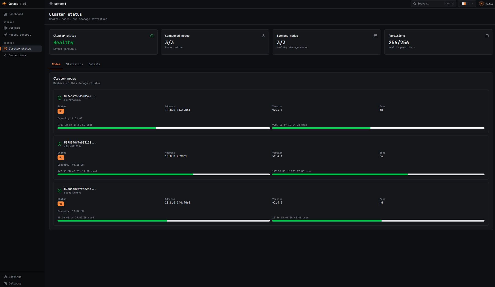

# Kuraban

[](LICENSE)
[](https://go.dev/)

*Kuraban* (蔵番) is Japanese for the keeper of a storehouse: the one who guards what is stored and decides who gets in. It is a web interface for [Garage](https://garagehq.deuxfleurs.fr/), the S3-compatible distributed object storage. It manages buckets, objects and access keys, shows cluster state, and keeps its own metrics history, so you don't need a separate Prometheus and Grafana stack.





## Features

- **Buckets and objects.** Create and configure buckets, set quotas and website hosting, browse objects with prefix and recursive search, upload with drag and drop, preview, download and bulk-delete files and folders.
- **Access keys.** Create keys, grant per-bucket read, write and owner permissions, reveal secrets.
- **Cluster.** Node status, layout overview, health, per-node statistics.
- **Dashboard.** S3 traffic, latency percentiles, error rates, storage growth, disk usage, block I/O, resync and RPC metrics. History is stored in a local SQLite database with automatic 5-minute and hourly rollups.
- **Multiple clusters.** Add several Garage clusters and switch between them from the header.
- **Authentication.** Local admin account, login with the Garage admin token, or OIDC (Keycloak, Authentik, etc.).
- **Team-based access control.** Optional, for OIDC users. See [docs/access-control.md](docs/access-control.md).
- **Runtime settings.** Monitoring interval and retention, dashboard thresholds, log level and IP allowlists are changed in the UI without a restart.
- **Interface.** English and Russian, several color themes with light and dark variants, command palette (`Ctrl+K`).

Garage admin API v1 and v2 are both supported. Some cluster statistics are only available on v2.

## Quick start

Requirements: Docker with Compose v2 and a running Garage cluster. To set up a local Garage for testing, see [docs/garage-setup.md](docs/garage-setup.md).

1. Download the example Compose file:

   ```bash
   curl -o docker-compose.yml https://raw.githubusercontent.com/Mimic890/kuraban/main/docker-compose.example.yml
   ```

2. Start the container:

   ```bash
   export KURABAN_AUTH_BOOTSTRAP_TOKEN="$(openssl rand -hex 32)"
   docker compose up -d
   ```

3. Open http://127.0.0.1:8080 and create the admin account (password of at least 12 characters).

4. Add a cluster: enter the S3 endpoint (for example `http://garage:3900`), the admin endpoint (`http://garage:3903`) and the `admin_token` from your `garage.toml`.

> [!IMPORTANT]
> The first person to open the UI creates the admin account. Keep the port closed to the outside until setup is done, or provision the account up front with `KURABAN_AUTH_ADMIN_USERNAME` and `KURABAN_AUTH_ADMIN_PASSWORD`.

The example binds to `127.0.0.1` and runs in `development` mode. For a public deployment, put the UI behind a reverse proxy with HTTPS and set `KURABAN_SERVER_ENVIRONMENT=production` and `KURABAN_SERVER_ROOT_URL=https://your-domain`.

## Configuration

The basics are set with environment variables:

| Variable | Default | Description |
|---|---|---|
| `KURABAN_SERVER_HOST` | `::` | Listen address. |
| `KURABAN_SERVER_PORT` | `8080` | Listen port. |
| `KURABAN_SERVER_ENVIRONMENT` | `production` | `production` or `development`. Production enforces secure cookie and OIDC settings. |
| `KURABAN_SERVER_ROOT_URL` | | External URL of the UI. Required for OIDC. |
| `KURABAN_DATA_DIR` | `data` | Persistent state directory (`/app/data` in Docker). Mount a volume here. |
| `KURABAN_LOGGING_LEVEL` | `info` | `trace`, `debug`, `info`, `warn`, `error`. |

Everything else (first-run provisioning, OIDC, CORS, the `/metrics` endpoint, request limits, the YAML config file and secrets from files) is covered in [docs/configuration.md](docs/configuration.md).

### Garage metrics

The S3, block and RPC charts read Garage's `/metrics` endpoint using the cluster admin token. If `metrics_token` in `garage.toml` differs from `admin_token`, make them equal or remove `metrics_token`. Cluster, disk and bucket charts work either way.

## Documentation

- [Configuration reference](docs/configuration.md)
- [Local Garage cluster for testing](docs/garage-setup.md)
- [Multi-user access control](docs/access-control.md)
- [Architecture](ARCHITECTURE.md)
- [Contributing and development setup](CONTRIBUTING.md)

## License

Copyright (C) 2026 Mimic890

This program is free software: you can redistribute it and/or modify it under the terms of the GNU Affero General Public License, version 3. See [LICENSE](LICENSE) for the full text.
